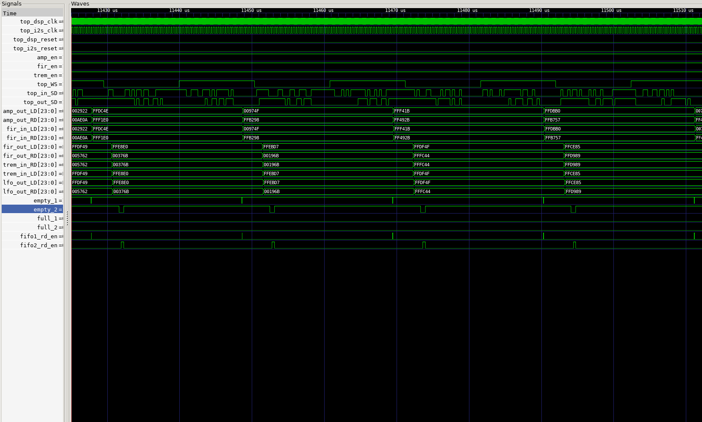

# FPGA Audio DSP Chain
[](https://github.com/minhdungtran/fpga-audio-dsp-chain/actions/workflows/CI.yml)

A fixed-point digital audio effects pipeline implemented in Verilog and verified with Cocotb.

## Author

**Author:** Tran Minh Dung  
**HDL:** Verilog  
**Verification:** Cocotb  

## Final Goal

The final goal of the project is to demonstrate the DSP chain on FPGA hardware as a low-latency real-time guitar effects processor. Guitar signals will be fed into the system, processed by the FPGA, and output as modified audio. The design will function similarly to a digital effects pedal.

## Signal Chain

```
I2S RX → Async FIFO → Amp → FIR Filter → Tremolo (LFO + Amp) → Async FIFO → I2S TX
```

## Clock Domains

The design spans two independent, asynchronous clock domains, with the DSP effects running at a higher frequency.

| Clock | Domain |
|---|---|
| `dsp_clk` | RTL processing (Amp, FIR, Tremolo) |
| `i2s_clk` | I2S bit clock (RX/TX) |


> **Scope note:** The current project has been implemented and verified in simulation, so no final hardware clock frequency is specified yet. The DSP clock must be fast enough for continuous audio processing without dropping samples. A later project phase will establish a synthesis/timing baseline and optimize the RTL for high Fmax and low processing latency.

## Quick start && Requirements
For the current projects, the following tools are required:
- Python 3
- python3-venv
- GNU Make
- Verilator 5.036+

To start the project, create and activate a virtual environment:
```
cd fpga-audio-dsp-chain
python3 -m venv .venv
source .venv/bin/activate
pip install -r requirements.txt
```
The following Make targets are available:
|Command|Description|
|---|---|
|make all| Run lint and all verification tests|
|make test| Run all cocotb unit and integration tests|
|make lint| Run Verilator lint checks on the RTL|
|make clean| Remove generated simulation files|

## Module Documentation

### I2S_rv — I2S Receiver
Standard I2S receiver for one stereo audio frame, sampling `SD` on the rising edge of `sck`.

- A transition on `WS` marks the start of a new channel slot, with a 1-`sck` delay at the
  start of each slot for frame synchronization (standard I2S: MSB appears one bit-clock after
  the `WS` edge).
- After the delay, `WIDTH` serial bits are shifted in MSB-first.
- Left and right channel data are captured into internal shift registers; once both channels
  have arrived, they are copied to `output_LD` / `output_RD`.
- `data_ready` pulses for one `sck` cycle when a complete stereo frame is available; outputs
  hold their value until the next complete frame.

### I2S_TX — I2S Transmitter
Serializes parallel stereo samples onto `SD`, shifting on the falling edge of `sck` (opposite
edge from the receiver, as required by the I2S protocol), with `WS` selecting the active channel.

- Same 1-`WS`-clock frame-sync delay as the receiver.
- When `data_valid` is asserted, `input_LD` / `input_RD` are latched into `pending_LD` /
  `pending_RD`; `pending_valid` pulses high until the pending sample is moved into the transmit
  shift registers.
- On the `Prev_WS = 1 → WS = 0` edge (start of a new WS cycle), `pending_LD` / `pending_RD` are
  loaded into `reg_LD` / `reg_RD` and shifted out MSB-first for `WIDTH` bit-clocks.
- `reset` clears all internal registers, counters, and the serial output.

### FIR — 63-Tap Stereo FIR Filter
Time-multiplexed FIR low-pass filter: separate circular sample buffers per channel, one shared
MAC datapath.

- On `data_valid`, one signed 24-bit L/R frame is stored into the circular buffers; the module
  then runs all 63 taps for the left channel, then all 63 for the right.
- **Arithmetic:** 24-bit signed samples, Q1.15 signed 16-bit coefficients (loaded from a memory
  file), 48-bit accumulator; final result is rounded, shifted right by 15, and saturated back
  to 24 bits.
- **Pipeline states:** `CLEAR` (zero buffers after reset) → `IDLE/STORE` (capture new frame) →
  `MAC` (one multiply-accumulate per clock) → `ROUND/SCALE/SAT` (convert accumulator back to
  24-bit audio) → `DONE` (latch each channel result, pulse `data_ready` once both are valid).
- Left/right channels have independent sample histories but share the coefficient ROM,
  multiplier, accumulator, and output logic.

### Amplifier — Fixed-Point Stereo Gain
Multiplies signed PCM samples by a signed Q2.14 fixed-point gain `G` (`gain_real = G / 2^14`).

- On `data_valid`, `in_LD` / `in_RD` are captured and multiplied by `G`.
- The product is arithmetically shifted right by 14 bits to rescale back to normal PCM, then
  saturated to the valid signed `WIDTH`-bit range (saturation is checked *after* the shift, not
  right after the multiply).
- `data_ready` pulses for one `sck` cycle when `out_LD` / `out_RD` hold a valid frame; outputs
  hold until the next frame completes.
- Non-negative gain = normal volume control; negative gain is valid but inverts waveform
  polarity — this dual role is what lets the same block double as the tremolo's modulation stage.

### tremolo_lfo — Tremolo Low-Frequency Oscillator
Generates a time-varying, unipolar sine gain multiplier and hands it off to a downstream
`Amplifier` instance, which is what actually applies the volume modulation — together the two
blocks form the tremolo effect.

- **LFO:** 16-bit phase accumulator, incremented by `control_rate` per valid audio frame; the
  upper 8 bits index a 256-word ROM of a unipolar sine wave in U0.14 format.
- **Depth:** `control_depth` is an unsigned U0.14 fraction controlling effect intensity.
- **4-stage pipeline**, advancing on `data_valid`:
  1. `data_valid` — capture `in_LD`/`in_RD`, step the phase accumulator
  2. `multi_D` — multiply the U0.14 ROM value by U0.14 `control_depth`
  3. `shift_D` — truncate the 28-bit product back to U0.14
  4. `subtract` — subtract the depth-scaled LFO value from digital 1.0 to produce
     `tremolo_gain`
- `out_LD` / `out_RD` output the original audio, delayed to match the 4-cycle pipeline so
  audio and gain stay synchronized.
- `data_ready` pulses for one `sck` cycle once the synchronized audio and `tremolo_gain` are
  ready to feed the downstream `Amplifier`.

## Verification

All testbenches are written in [cocotb](https://www.cocotb.org/). Modules with numeric behavior
(FIR, Amplifier, LFO, and the full DSP chain) are checked bit-exact against Python golden models.

### Unit Tests (`tb/unit/`)

**`i2s_rv` — I2S Receiver**
- Edge-case frames (silence, all-ones, alternating bits, sign boundary, LSB-only) plus 100
  randomized stereo frames, checked against the transmitted bitstream.
- Confirms `data_ready` pulses for exactly one clock and outputs hold stable until the next frame.

**`i2s_tx` — I2S Transmitter**
- Same edge-case and 100-random-frame coverage, verified by reconstructing the serialized bitstream.
- Confirms samples only latch in at a `WS 1→0` frame boundary, not mid right-channel.
- Confirms the 1-clock I2S timing delay after a `WS` edge.
- Confirms a second `data_valid` pulse before the next frame boundary overwrites the pending
  sample with the latest one, so no stale data is transmitted.
- Confirms `SD` stays at 0 after reset until a sample is actually loaded.

**`fir` — FIR Filter**
- 200 random stereo frames checked bit-exact against a Python golden model built from the same
  `.mem` coefficient file used in synthesis.
- All-zero input regression, including confirming the circular sample buffers reset to zero.
- Per-tap impulse response test on each channel independently, confirming the 63-tap response
  ends exactly on schedule with no residual output.
- Handshake timing test confirming `data_ready` latency and single-cycle pulse width.

**`amplifier` — Amplifier**
- 12 hand-picked corner cases: silence, unity gain, negative samples, half gain, mute, positive
  and negative full-scale saturation, phase inversion, and shift-rounding edge cases.
- 1,000 randomized (sample, gain) pairs checked bit-exact against a Python model.
- Internal FSM sequencing check (multiply → shift → saturation-check → ready).
- Confirms `data_ready` stays low with no valid input.

**`lfo` — Tremolo LFO**
- 500-cycle phase-accumulator test confirming correct wraparound at 16 bits.
- Pipeline-alignment test confirming audio samples emerge in sync with the computed gain after
  the 4-cycle pipeline.
- Gain-calculation test across multiple `control_rate` / `control_depth` combinations (including
  depth = 0, i.e. effect fully off) checked against a Python sine-ROM model.

### Integration Tests (`tb/integration/`)

**`Audio_Passthrough`**
- Full RX → TX path (through the FIFOs) round-tripped for edge-case and 100 random frames,
  confirming correct frame ordering end to end.
- Confirms output stays at 0 immediately after reset.
- Confirms a mid-frame reset recovers cleanly and subsequent frames are still received correctly.

**`dsp_chain`** — the most complete test, exercising the full top-level design across its two
clock domains (a faster DSP clock and the slower I2S bit clock, connected through the async FIFO)
- All eight combinations of the amp/FIR/tremolo enable bits, each checked against a chained
  Python golden model (amp → FIR → tremolo).
- 500-frame long-run soak test with all three effects enabled.
- Mid-stream reset recovery.
- Mid-stream reconfiguration — enable bits, amp gain, and tremolo rate/depth are each changed
  while audio is flowing, confirming the design adapts correctly without corrupting in-flight
  samples.
- Full-dynamic-range saturation test (full-scale positive, full-scale negative, alternating
  +/- impulses) through the combined amp + FIR path.

The remaining testbenches (`fifo`, `fifo_integration`, `dsp_amp`, `dsp_fir`, `dsp_tremolo`,
`fir_tx`, `rv_fir`) cover the individual sub-block and pairwise integration paths and follow the
same self-checking, cocotb-driven approach.

### Example Waveform



Capture from a `dsp_chain` simulation with all three effects enabled, showing the two clock
domains (`top_dsp_clk`, `top_i2s_clk`), the I2S `WS`/`SD` lines, and the parallel sample values
at each stage. The intermediate values line up exactly stage to stage — `fir_in_LD/RD` matches
`amp_out_LD/RD`, and `trem_in_LD/RD` matches `fir_out_LD/RD` — which is a quick visual confirmation
that the pipeline wiring carries samples through amp → FIR → tremolo without corruption. The
`empty_1/2`, `full_1/2`, and `fifo1_rd_en`/`fifo2_rd_en` traces show the FIFO handshaking that
crosses between the two clock domains.

# Project Goals
- [ ] Establish synthesis and timing baseline
- [ ] Optimize DSP processing latency and throughput
- [ ] Deploy the design to an Arty Z7-20
- [ ] Interface an external I2S ADC/DAC
- [ ] Demonstrate real-time guitar processing

## License

This project is licensed under the MIT License — see [LICENSE](LICENSE).

